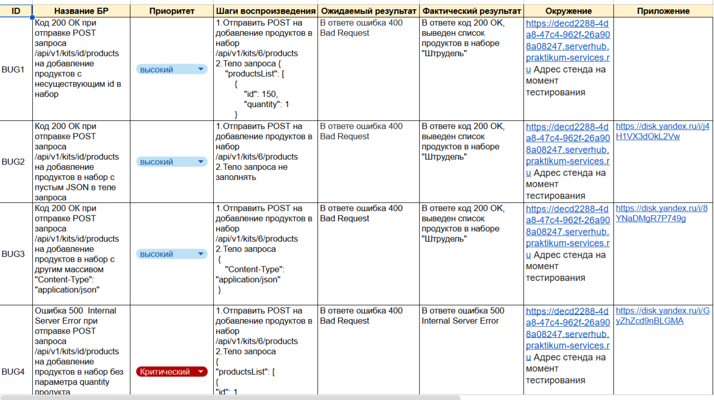

Проект Яндекс Прилавка (API)
Яндекс Прилавок - это сервис, который предоставляет предпринимателям и компаниям возможность создавать 
собственные виртуальные магазины в онлайн-пространстве. 

Задачи:

Проанализировать требования к новой функциональности бэкенда Яндекс Прилавка
Изучить документацию к API в Apidoc
Спроектировать тесты в виде чек-листа, чтобы покрыть новую функциональность
-Работа с наборами: возможность добавлять продукты в набор
-Работа с курьерами: возможность проверить, есть ли доставка курьерской службой «Привезём быстро» и сколько она стоит
-Работа с корзиной:
возможность получить список продуктов, которые добавили в корзину
возможность добавлять продукты в корзине
возможность удалять корзину
Протестировать API через Postman и завести баг-репорт

Выполнено:
* Анализ документации:технические требования к бэкенду и схемы API-запросов в ApiDoc.
* Проектирование тестов: разработан чек-лист для проверки  функциональности:
  * Работа с наборами продуктов (добавление продуктов в набор).
  * Расчёт доставки курьерской службой «Привезём быстро».
  * Логика работы корзины (добавление, получение списка, изменение и удаление).
* Тестирование REST API:
  Выполнены позитивные и негативные проверки в Postman

  Заведен баг-репорт.
 Инструменты: Postman, ApiDoc, Google Sheets

 Фрагмент чек-лист тестирования API:checklist.png

Фрагмент баг-репорта по результатам тестов:*

 
